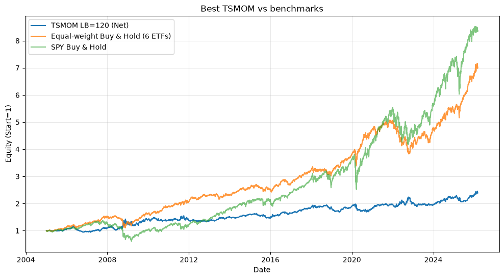
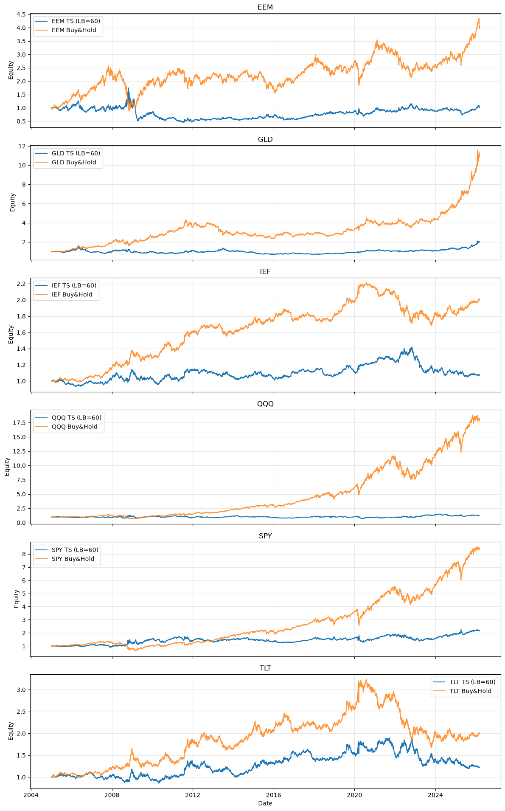
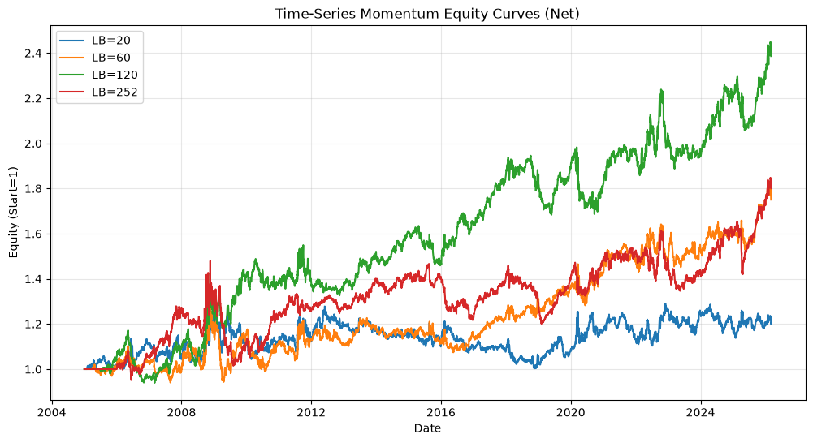
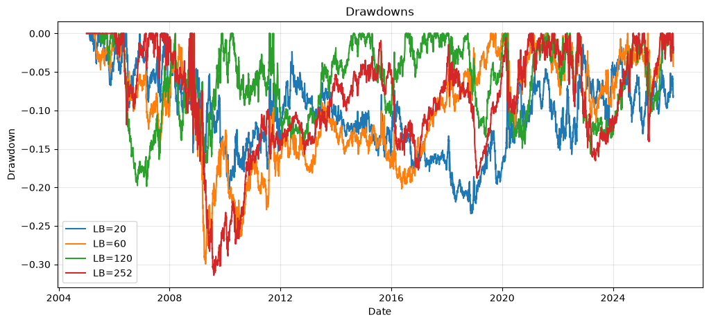

# Time-Series Momentum Back-tester

A long/short time-series momentum (TSMOM) back-test on six ETFs (SPY, QQQ, EEM, TLT, IEF, GLD), 3 Jan 2005 to 5 Mar 2026, in [`tsmom_backtest.ipynb`](tsmom_backtest.ipynb).

## Method
- **Signal:** sign of the trailing `lookback`-day return. Long if positive, short if negative.
- **Execution:** the signal is shifted one day (`signal.shift(1)`), so a position is held the day after the signal forms. This avoids look-ahead bias.
- **Costs:** 2 bps per unit of turnover.
- **Portfolio:** equal weight across the six assets.
- **Lookbacks compared:** 20, 60, 120, 252 trading days.
- **Data:** Yahoo Finance via `yfinance`, adjusted prices, end date pinned to `2026-03-06` (exclusive) for reproducibility.

## Results (net of costs, full period)

| Lookback | Total return | CAGR | Vol | Sharpe | Max drawdown | Avg daily turnover |
|---|---|---|---|---|---|---|
| 20 | 20.28% | 0.88% | 11.59% | 0.13 | -23.41% | 0.19 |
| 60 | 75.01% | 2.68% | 11.30% | 0.29 | -29.95% | 0.10 |
| **120** | **138.61%** | **4.20%** | **11.21%** | **0.42** | **-19.87%** | **0.06** |
| 252 | 80.04% | 2.82% | 10.66% | 0.31 | -31.42% | 0.04 |

> **In-sample caveat:** the 120-day lookback is the one with the highest Sharpe over the whole sample, so these figures are in-sample and optimistic. There is no train/test split or walk-forward test yet.

### Against buy-and-hold benchmarks

The fair benchmark is an equal-weighted, daily-rebalanced buy-and-hold of the same six ETFs. It beat the best TSMOM lookback on both CAGR and Sharpe. TSMOM's one edge was a shallower max drawdown.

| | CAGR | Vol | Sharpe | Max drawdown |
|---|---|---|---|---|
| TSMOM, 120-day (net) | 4.20% | 11.21% | 0.42 | -19.87% |
| Equal-weight buy-and-hold (6 ETFs) | 9.63% | 11.13% | 0.88 | -29.02% |
| SPY buy-and-hold | 10.56% | 19.00% | 0.62 | -55.19% |



### 60-day signal vs buy-and-hold, per asset

The 60-day signal returned less than buy-and-hold on all six assets. It cut max drawdown on only three: SPY, TLT and QQQ. It was worse on GLD, IEF and EEM.

| Asset | TS final | B&H final | TS CAGR % | B&H CAGR % | TS Sharpe | B&H Sharpe | TS MDD % | B&H MDD % |
|---|---|---|---|---|---|---|---|---|
| SPY | 2.15 | 8.35 | 3.68 | 10.56 | 0.29 | 0.62 | -28.40 | -55.19 |
| GLD | 1.98 | 10.84 | 3.28 | 11.93 | 0.27 | 0.72 | -54.26 | -45.56 |
| TLT | 1.21 | 1.98 | 0.92 | 3.30 | 0.14 | 0.29 | -36.95 | -48.35 |
| QQQ | 1.17 | 18.07 | 0.76 | 14.68 | 0.14 | 0.74 | -43.97 | -53.40 |
| IEF | 1.07 | 1.99 | 0.33 | 3.32 | 0.08 | 0.52 | -26.01 | -23.92 |
| EEM | 1.00 | 3.96 | 0.00 | 6.73 | 0.14 | 0.37 | -73.77 | -66.43 |



### Equity curves and drawdowns



## Run it
```bash
python3 -m venv .venv && source .venv/bin/activate
python -m pip install -r requirements.txt
jupyter notebook tsmom_backtest.ipynb
```

Yahoo revises adjusted prices over time, so a re-run can differ from the tables above in the second decimal place.

## Limitations
- Lookback selected in-sample (see above).
- Costs are a flat 2 bps per unit of turnover. There is no slippage or borrow cost model.
- Equal-weighted, daily-rebalanced positions; no volatility targeting.
